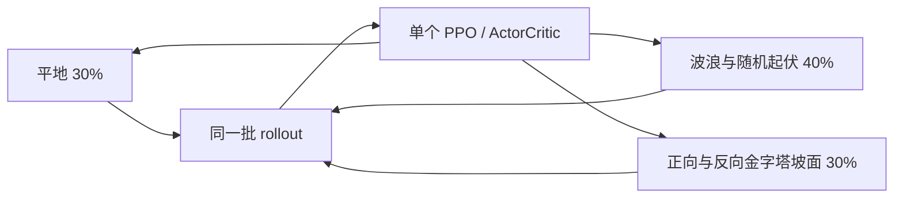

> 历史上游记录：2026-11-08 unified 实验的工具说明，2026-11-12 从 `tools/README.md` 原文保留。
> 下文服务器路径、运行状态、plan 和监控命令描述历史实验，不代表当前个人随机地形任务。当前入口见 [工具索引](../../tools/README.md)。不要直接把历史启动命令应用到新任务。

# 统一轮腿行走训练（2026-11-08）

服务器工作目录：`/data/wheelbipe-unified-locomotion-20261108`。
本地实现：`/home/yyy/wheeled-legged_RL-main/scripts/unified_locomotion`。
原四组任务及检查点保留在 `/data/wheelbipe-v14-6-training-20261108`，仍保持暂停。

## 策略如何共享经验

同一个训练进程创建 256 个并行环境、一个 ActorCritic、一个 Adam 优化器。
每次 PPO 更新汇集全部环境的 24 步 rollout（6144 个转移），各地形共同更新同一套参数。
GPU 0 训练，GPU 1 定期做独立验证。没有为每种地形另建策略，也没有合并旧策略权重。



固定每批环境的地形家族比例，在各家族内更换地块、位置、朝向和难度，防止短回合的困难地形挤掉其他家族。
使用本仓库 `manager/mdp/isaaclab/terrains.py` 对应的 Isaac Lab 平地、波浪、随机起伏、正反金字塔坡面家族；不含台阶。
地块为 16×12 m，6 档难度、20 列；波浪和随机起伏地块中心有平地，并以 1 m 光滑区域过渡到起伏部分。
坡度参数由 0.03 渐增至 0.25，波浪参数为 0.003–0.04 m。随机起伏离散采样范围随难度由 ±3 mm 增至 ±25 mm；上游三次插值会有超调，预检查最高档实际峰峰值约 72 mm。
这些是仿真训练范围，不是实机通过性结论。

## 速度与数据分布

从第一次更新就包含完整 `[-2.7,+2.7] m/s` 指令支持域：70% 分箱采样覆盖全范围、20% 低速、10% 停止/原地转向；其中另保留少量正负 2.7 m/s 端点。
偏航指令 ±0.8 rad/s，约束 `abs(vx*yaw) <= 1.5`；55% 样本为直行。
重采样间隔为 1.5–4 s，覆盖加速、刹车、反向和转弯切换。异步单环境重采样采用随机箱偏移，避免总落在第一个负高速区间。

每 100 个控制步写 `diagnostics/unified_locomotion/<phase>/training_health.json`，包含：

- 地形×指令速度、地形×实际速度直方图，正负端点实测范围。
- 各地形三种重置模式次数、终止/边界/随机时限/卡住计数。
- 刹停、反向、纯偏航和行驶转弯的采样次数。
- 35 维策略观测实际最小值/最大值，课程等级与坡地垂直运动统计。
- 闭链误差、限力和域随机化引擎回读数据。

覆盖统计可发现缺失的训练区域；它不等于消除了所有 OOD，也不证明全部指令已经跟踪成功。

## 重置与课程

每次重置保留验证过的闭链姿态库，重置全部普通关节和气弹簧；独立采样两侧合法姿态，不直接扰乱被动关节角破坏约束。

| 模式 | 比例 | 初始条件 |
| --- | --- | --- |
| 静止 | 45% | 静止车体与轮速，坡面姿态加轻微扰动 |
| 滚动 | 35% | 速度接近当前指令并扰动 ±0.2 m/s，限制至 ±2.7；轮速按速度/轮半径匹配 |
| 恢复 | 20% | 滚动状态，加最多约 ±4° 的姿态扰动、±0.15 m/s 侧滑、±0.4 rad/s 偏航速度 |

位置在地块中心 ±2 m 内随机，朝向既有纵向正反方向，也有全方向采样。
从实际 USD 碰撞地形构建射线查询网格，计算局部坡面倾斜及两轮接地点，按轮胎足迹抬高初始车体，避免轮胎从地下开始。

重置条件：

- 碰撞/倾倒保留原终止规则，将确认等待改为 2 个控制步（40 ms）。初始化检查点保存的旧配置为 20 步（400 ms）。
- 原弹簧行程及数值保护保留，并加入全部原生关节的非有限/速度超过 200 的即时终止。该检查覆盖原先遗漏的被动关节。
- 指令绝对值超过 0.7 m/s，而实际前向速度低于 0.12 m/s，回合开始 3 秒后连续卡住 2 秒，按失败终止。
- 超出各自地块内侧边界或达到随机 6–14 秒时限，按截断处理并保留价值自举。

在基础 `_reset_idx` 清零回合长度之前统计成功：至少 3 秒/1.5 m，或者至少 1.2 秒/3 m 的成功边界穿越，平均前向速度误差小于 0.45 m/s，且没有失败终止。连续成功两次升一级；2 秒内失败降一级；20% 回放已解锁的容易等级，10% 探索下一级。高速成功穿越无需等待 3 秒，避免短地块阻止高速样本升级。

质量、惯量、摩擦、阻尼、限力、传感噪声、延迟、外力、滚阻继续使用原来已验证的域随机化。物理参数仍在环境启动时采样；延迟随重置采样，噪声逐步采样，外力按间隔重新采样。

## 初始化、检查点与验证

初始化演员来自原颠簸组候选第 3000 次，SHA256：
`3608c93f2a0049bc70bf7e29cb6cbe775aeca071c715d11c90ee7dd5e92e8374`。
只迁移演员，价值网络、Adam、迭代号重新开始，探索标准差重设为 0.35。
训练保存 `params/actor_transfer.json` 验证演员一致、价值网络重新初始化、优化器初始为空；`training_updates.jsonl` 记录真实梯度、损失和演员/价值网络参数变化。

速度奖励指数核由 0.09 放宽到 0.36，平方误差权重由 -2 调为 -0.35，以便速度大误差阶段仍有可用反馈；降低坡面上的世界坐标平姿态奖励权重。模型、轮径、轮腿限力、气弹簧参数保持原值。
物理 400 Hz，控制 50 Hz。先完成 16 次 PPO 更新，独立验证后精确恢复优化器和迭代号，继续到新任务总计 12000 次。
每 100 次保存；每 500 次在固定验证分布（另一地形种子、5 地形×9 个有符号速度、静止起步）评分。候选评分综合各家族误差、失败频率及最差家族，避免仅按平地挑选。
最终使用另外保留的种子在 0/2/5 档评估。最终不同难度的报告不会与固定验证分布混用来选候选。

每个模型旁有 `.pt.curriculum.pt`，恢复课程进度、覆盖统计和观测范围；不恢复仿真器瞬时接触状态。精确续训校验针对模型、优化器及下一次 PPO 迭代。
评估物理失败会停止训练；普通策略失败如摔倒会记录在评分中，不能用“物理 PASS”当作策略收敛。

已执行的预检查：100000 次批采样、1000 次单环境异步采样、三种重置、地形难度增高、边界截断、清零前课程升级，以及 45 个地形×速度组合的真实仿真。
初始演员在该 4 秒矩阵中前向速度 MAE 约 0.824 m/s，发生 138 次失败；±0.8 m/s 和静止组合均无失败，高速仍需训练。
缩短终止确认后闭链峰值约 0.453 mm，腿峰值约 37.93 N·m、轮峰值约 4.97 N·m。更早的长延迟试验出现过 11.1 mm 瞬时误差，原始事件和日志已保留，未作为通过结果。

16 次试训已经完成：98304 个转移、320 次 Adam 步，所有更新的损失、梯度和参数均有限且参数确实发生变化。累计演员参数变化 L2 约 0.657，价值网络约 4.994；训练采样闭链峰值约 1.019 mm。
随后在种子 71903、45 个地形×速度组合、每个 8 秒的验证中，闭链峰值约 0.837 mm、腿峰值约 39.89 N·m、轮峰值约 4.96 N·m，物理检查通过。±0.8 m/s 和静止组合均无失败；高速组合仍有大量失败，整体速度 MAE 约 0.756 m/s、212 次失败终止。该试训权重尚未达到全速度范围的通过标准。此验证与初始检查的种子和时长不同，不用于直接推断训练前后改善幅度。

## 运行与查看

在服务器上查看状态：

```bash
python3 /data/wheelbipe-unified-locomotion-20261108/tools/status.py
```

状态文件：`training/status.json`；训练日志：`training/pilot.log`、`training/long_16.log`；调度日志：`training/supervisor.log`。
检查点位于 `logs/rsl_rl/wheelbipe_unified_locomotion_20261108/<run>/`，验证报告位于 `evaluation/`。

训练进程意外停止后，先检查失败原因和物理报告，再恢复：

```bash
cd /data/wheelbipe-unified-locomotion-20261108
nohup python3 tools/supervise.py --root /data/wheelbipe-unified-locomotion-20261108 --resume > training/resume_supervisor.log 2>&1 < /dev/null &
```

调度器使用文件锁避免重复启动；已有检查点时禁止再启动一次从头训练。
`configure.py` 只允许对全新的隔离副本安装，不会修改原四组任务。
