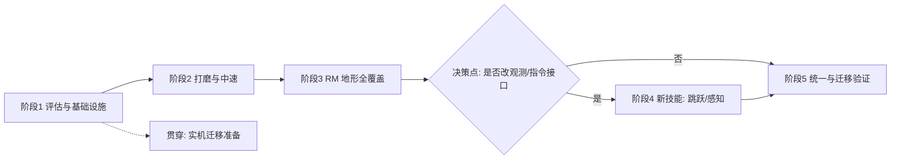

# Wheelbipe 长期优化方案

> 日期：2026-11-14
> 关联文档：[robomaster_wheelleg_evaluation_standard.md](./robomaster_wheelleg_evaluation_standard.md)（评价标尺）、[optimization_roadmap_20261114.md](./optimization_roadmap_20261114.md)（近期方向与具体改动）
> 当前基线：`dirD2_model_5`（400 Hz，35 维本体感知 Actor，78 维 Critic，6 维动作）

本文是长期方案，回答三个问题：**最终要做成什么样**、**分几个阶段走、每个阶段什么时候算完成**、**哪些基础能力需要贯穿始终地建设**。具体到文件和参数的改动见近期路线文档。

> 时间均为粗略估计，以“周”为单位，按每轮一个可 review 的小目标推进；实际节奏以用户 review 为准。

---

## 一、长期目标

### 1.1 最终形态

一个在 RoboMaster 评价标尺上**主要维度达到 A 级**、并且**具备上实机条件**的轮腿控制策略：

| 维度 | 当前 | 长期目标 |
| --- | :---: | :---: |
| 下台阶姿态（云台稳定） | A | A+：回弹与常值偏置基本消除 |
| 坡面与过渡 | B+ | A：覆盖 27%–30% 坡 |
| 低凸起抗扰 | B | A：25–40 mm 凸起、散落弹丸、侧向撞击稳定 |
| 速度与转向 | C | A：1.5–2.0 m/s，`\|wz\| ≥ 1.5 rad/s` |
| 垂直上台阶 | D | B：60–120 mm 可通过（跳跃或感知） |
| 实机迁移 | 未评估 | 通过延迟/功率/模型误差压力测试 |

### 1.2 非目标（明确不追求）

- 不追求 S 级指标（3–5 m/s 冲刺、10 rad/s 小陀螺、200 mm 跳台），除非 A 级全部达成后再评估。
- 不追求倒地自救，除非项目确认要上实机比赛。
- 不重写已经验证过的闭环连杆资产和物理参数。

---

## 二、指导原则

1. **回归优先**：任何新能力不能以牺牲已有能力为代价。统一回归门槛见第七节。
2. **先度量，再优化**：没有自动化指标的问题不调奖励。
3. **新地形新建图**：不修改现有 3×3 地图的定义，保持历史结果可比。
4. **一次只改一个主要变量**：速度、坡度、奖励、观测接口分开改，便于定位退化原因。
5. **接口变更需要决策点**：改变 35 维 Actor 输入或 6 维动作是重大决策，需单独评审（见阶段 4）。
6. **400 Hz 不降级**：所有训练和评估保持 `WHEELBIPE_INTEGRATION_SUBSTEPS=2`。

---

## 三、阶段规划

### 阶段 1：评估与基础设施（约 1–2 周）

**目标**：把“好不好”变成可自动计算的数字。

**工作**
- 速度/转向扫描、急停阶跃、姿态质量（回弹、roll 偏置）、近似机械功率四类评估脚本。
- 一键基准脚本：输入检查点，输出完整对照表（坡面、过渡、走廊、障碍、新指标）。
- 检查点登记表：每个候选检查点记录 sha256、父检查点、profile、训练规模、基准结果。

**完成标准**
- `dirD2_model_5` 在所有新指标上有基线数值。
- 一键基准可以在 7 张 GPU 上并行跑完，并生成 Markdown 表格。

---

### 阶段 2：现有能力打磨 + 中速（约 3–5 周）

**目标**：先把现有能力做干净，再把速度提升到中速。

**工作**
1. 下台阶回弹抑制、横滚偏置诊断与消除（先确认是策略问题还是资产左右不对称）。
2. 25/40 mm 低台阶斜向接近训练，解决双轮不同步触阶的 `roll` 失败。
3. 速度课程：`±0.65 → 1.2 → 2.0 m/s`，偏航 `±0.45 → 1.0 → 1.5 rad/s`，缩短指令重采样间隔。
4. 训练方式从小规模 actor-only 微调过渡到**含 critic 的较长训练 + 课程**。

**完成标准**
- 下台阶回弹 `< 0.15 m/s`、roll 偏置 `< 0.5°`。
- `platform_up_25mm ≥ 8/9`、`platform_up_40mm ≥ 6/9`。
- 平地 1.5 m/s、1.0 rad/s 跟踪误差均 `< 0.1`，急停 `max|pitch| ≤ 8°`。
- 全部回归门槛通过。

**风险**：提速后下台阶抛射距离增大，`stairs_down_90mm` 可能退化 → 在速度课程中保留障碍跑道比例，并按速度分段统计下台阶成功率。

---

### 阶段 3：RM 地形全覆盖（约 3–4 周）

**目标**：覆盖 RM 赛场上不需要跳跃的全部地形和扰动。

**工作**
1. **陡坡地图**：22% / 26% / 30% 上下坡，含坡顶坡底折角；先零样本评估，再课程微调。
2. **散落碎障**：在平地和坡面上随机放置 17 mm / 42 mm 级别的小凸起（模拟弹丸），训练单轮压障。
3. **侧向冲击**：把现有 `push_force_xy_N = ±8 N` 扩大到模拟碰撞的短时大冲量，评估不倒能力。
4. **中速 + 地形组合**：在 1.0–1.5 m/s 下重跑全部地形评估，而不是只在 0.65 m/s 下评估。

**完成标准**
- 30% 坡 3 种子全部通过，无托底。
- 碎障地形与侧向冲击下重置率达到设定阈值（阶段 1 确定具体数值）。
- 中速（1.0 m/s）下原有地形全部通过。

---

### 决策点：是否改变策略接口

阶段 3 完成后，需要在以下选项中做出决策（由用户确认）：

| 选项 | 内容 | 适用条件 |
| --- | --- | --- |
| A：保持 35 维接口 | 不做跳跃，专注阶段 5 的迁移验证 | 实机近期要部署，或 60 mm 以上台阶不是需求 |
| B：增加高度/跳跃指令 | 观测加入指令维度，放宽 `height_range` | 需要上台阶，且没有深度感知硬件 |
| C：增加地形高程观测 | 教师-学生蒸馏（见 4.2） | 需要上台阶，且实机有深度相机或激光 |

**决策依据**：阶段 1 的功率数据、阶段 2–3 的结果、实机硬件条件。

---

### 阶段 4：新技能（约 6–8 周，视决策点结果）

**选项 B 路线（跳跃）**
1. 高度指令跟踪：`height_range` 放宽到下蹲区间，验证闭环连杆误差仍 `< 2 mm`。
2. 原地跳跃单技能训练：确认 40 N·m / 17 rad/s 腿部电机能产生的离地高度。
3. 跳跃上台阶：60 mm → 90 mm → 120 mm 课程。
4. 与地形任务合并成统一策略，或者保留为独立技能策略加切换逻辑（见 4.3）。

**选项 C 路线（感知）**
1. 训练带高程观测的教师策略（仿真中直接读地形高度）。
2. 用带噪声和延迟的模拟深度观测蒸馏学生策略。
3. 评估感知噪声、遮挡、延迟下的退化程度。

**完成标准**：`platform_up_60mm ≥ 6/9`、`platform_up_120mm ≥ 3/9`，且全部回归门槛通过。

---

### 阶段 5：统一与迁移验证（约 2–4 周）

**目标**：产出最终检查点，并完成上实机前的仿真压力测试。

**工作**
- 统一回归：所有地形 × 多个速度档 × 多种子。
- 压力测试：动作/观测延迟、质量与摩擦超出训练范围、电机力矩衰减。
- 跨仿真器或跨物理参数验证（sim2sim），确认不是过拟合到某一组 PhysX 参数。
- 导出部署格式，核对输入输出与实机控制器一致。

**完成标准**：最终检查点在第七节全部门槛和压力测试中通过，形成交付报告。

---

## 四、贯穿各阶段的技术主线

### 4.1 训练方式演进

| 阶段 | 训练方式 | 说明 |
| --- | --- | --- |
| 当前 | actor-only 微调，`lr = 1e-5`，12–15 iter | 适合小修，不适合学新技能 |
| 阶段 2–3 | 含 critic 训练 + 课程，迭代数提升到数百级 | 学习速度和新地形 |
| 阶段 4 | 必要时从较早检查点或从头训练 | 接口改变后旧策略无法直接继承 |

**课程机制**：建议统一实现“成功率达标后扩大范围”的自动课程（速度范围、坡度、台阶高度共用一套逻辑），替代每次手动建新 profile。

### 4.2 教师-学生结构

当前 Critic 已有 78 维特权观测（含地形相对高度）。这是天然的教师信号来源：
- 短期：继续作为非对称 actor-critic 使用。
- 长期：若选择感知路线，可先训练使用特权信息的教师 Actor，再蒸馏给只用本体感知（或带噪声高程）的学生 Actor。

### 4.3 统一策略 vs 技能库

| 方案 | 优点 | 缺点 |
| --- | --- | --- |
| 单一统一策略 | 部署简单，切换平滑 | 能力越多越难训练，容易互相干扰 |
| 技能库 + 切换 | 每个技能单独优化 | 切换时刻可能不稳，需要上层逻辑 |

**建议**：阶段 2–3 坚持单一策略；跳跃如果难以并入，再考虑把跳跃作为独立技能。

### 4.4 地形生成器演进

- 当前：3×3 坡面 + 4 条障碍跑道。
- 阶段 3：陡坡图、碎障图、组合图分别建立，并保留旧图用于回归。
- 长期：参数化地形生成（坡度、台阶高、碎障密度作为课程变量），供自动课程调用。

### 4.5 奖励体系管理

- 每个奖励项记录：引入原因、引入时的检查点、对哪项指标有效。
- 新奖励项先在小规模实验中做消融，确认有效后再进入主线。
- 定期清理不再起作用的奖励项，避免奖励越来越复杂。

### 4.6 实机迁移准备（低成本，尽早开始）

- 域随机化加入动作/观测延迟。
- 功率统计纳入每次评估。
- 在每个阶段末尾都导出一次部署格式，提前暴露接口问题。

---

## 五、资源规划

服务器 `pi` 有 7 张 GPU（每张约 24 GB 显存）、48 个 CPU 核心。建议分配：

| 用途 | GPU | 说明 |
| --- | --- | --- |
| 主线训练 | 2–3 张 | 当前阶段的主要实验 |
| 消融/对照实验 | 1–2 张 | 奖励项或参数对照 |
| 评估与回归 | 2 张 | 一键基准并行运行 |
| 视频录制 | 按需 | 带渲染的录制较慢，只在里程碑时录制 |

---

## 六、风险与应对

| 风险 | 可能后果 | 应对 |
| --- | --- | --- |
| 新能力导致旧能力退化 | 冠军检查点无法更新 | 统一回归门槛 + 障碍跑道保持训练比例 |
| 高速下闭环连杆误差增大 | 训练崩溃或数值异常 | 阶段 2 监控 `max_loop_error`，必要时限制腿部动作速率 |
| 跳跃在当前腿部电机下不可行 | 阶段 4 路线 B 失败 | 先做原地跳跃可行性验证再投入 |
| 奖励项越来越多难以维护 | 调参效率下降 | 奖励登记与定期清理 |
| 仿真结果过拟合 PhysX 参数 | 实机表现差 | 阶段 5 做 sim2sim 和参数超范围压力测试 |
| 训练规模扩大后时间成本上升 | 迭代变慢 | 课程自动化 + 多 GPU 并行对照 |

---

## 七、统一回归门槛（每个新冠军必须满足）

1. 3 种子 3×3 坡面 `81/81`。
2. 24 个合法过渡 `24/24`。
3. 270 s 走廊 `9/9`，`resets = 0`。
4. `stairs_down_{30,60,90}mm` 3 种子 `27/27` 到达。
5. 400 Hz 闭环误差 `< 2 mm`，无数值异常。
6. 进入阶段 2 后增加：中速档（1.0 m/s）下第 1–4 项仍通过。
7. 进入阶段 3 后增加：30% 坡与碎障地形门槛。

---

## 八、里程碑总表

| 里程碑 | 预计时间 | 标志 |
| --- | --- | --- |
| M1 基线可度量 | 第 2 周 | 一键基准 + 新指标基线 |
| M2 干净基线 | 第 4 周 | 回弹/偏置/低台阶改进的冠军检查点 |
| M3 中速策略 | 第 7 周 | 1.5 m/s 跟踪达标且回归通过 |
| M4 RM 地形覆盖 | 第 11 周 | 30% 坡 + 碎障 + 冲击通过 |
| 决策点 | 第 11 周 | 确定是否改接口 |
| M5 新技能 | 第 17–19 周 | 60 mm 以上台阶通过（如选择） |
| M6 最终交付 | 第 19–23 周 | 统一检查点 + 压力测试报告 |

---

## 九、推进方式

按项目协作约定，每轮只完成一个可理解的小目标，交给用户 review 后再进入下一步。长期方案只规定方向和完成标准，具体每一步的改动在近期路线文档中逐步细化。

**第一步**：阶段 1 中的速度/转向扫描评估脚本。
