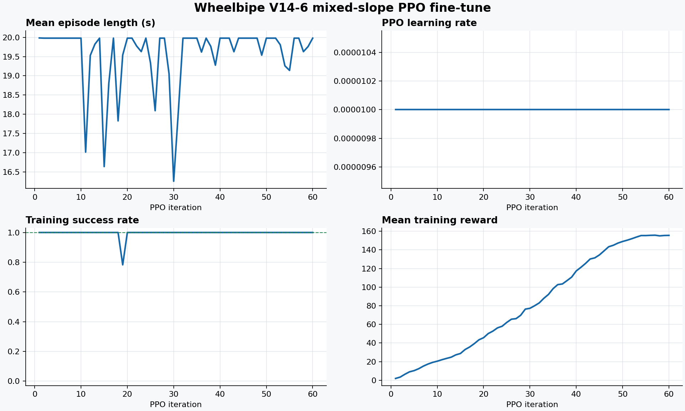
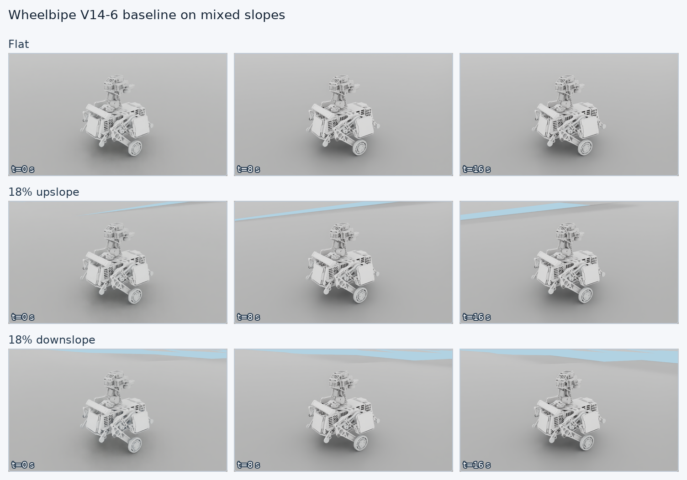
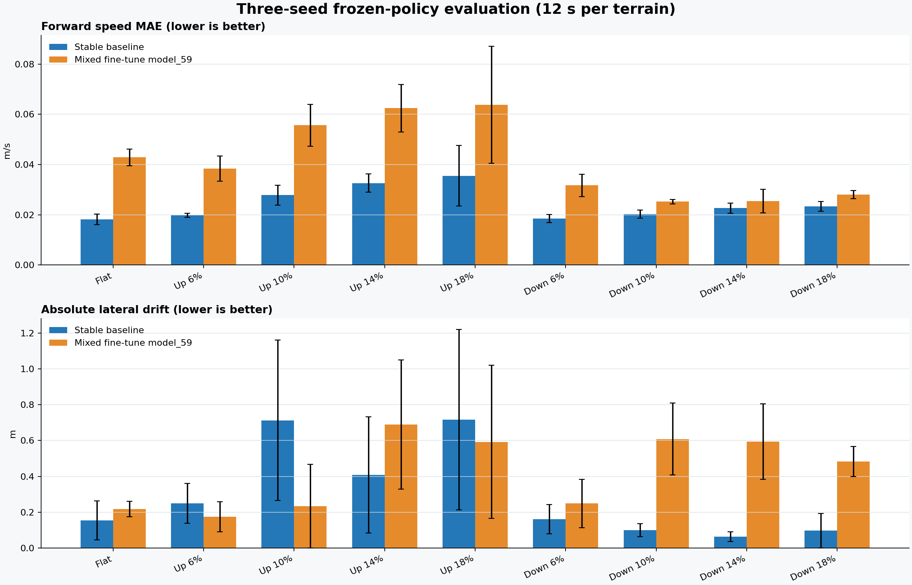

# Wheelbipe V14-6 混合坡度 PPO 实验

## 结论

本轮已经完成混合坡度 PPO 微调和三种子评估，但新模型 `model_59.pt` 没有超过原 baseline。最终推荐继续使用队友已验证的 `model_50.pt`，并将 `model_59.pt` 保留为实验候选。

推荐模型的 SHA-256：

```text
dd55308419fbd04eecaf213588dd1249a09ec7eba86073d8338d0b06b46c3a61
```

实验候选模型的 SHA-256：

```text
66f6fb81799a7c64f8edf6a9748a3f79fed4cb0c75e2630b54d54706f708230e
```

## 训练条件

- 初始权重：队友 `downhill_pilot/model_50.pt`
- 服务器工作区：`/data/wheeled-legged/projects/v14_6_mixed_slopes_20261111`
- 运行目录：
  `runs/train_Gli8zO/logs/rsl_rl/own_low_speed_exploration/2026-11-11_11-32-43_mixed_slopes_60`
- 环境数：256
- PPO 迭代：60
- 样本量：368,640 timesteps
- GPU：3
- 耗时：15 分 44 秒
- 物理频率：400 Hz
- 策略频率：50 Hz
- Observation：actor 35 维、critic 78 维
- Action：6 维
- 学习率：固定 `1e-5`
- 训练成功率：最终 100%
- 最终均值奖励：155.59

训练通过 `tmux` 启动，因此关闭本机终端不会终止服务器进程。训练已正常完成，当前没有残留训练会话。

地形包含平地，以及 6%、10%、14%、18% 的上坡和下坡。每个地块前有 2 m 平地起步区，坡面由精确三角网格生成，左右边缘高度一致，避免非预期的横向侧倾。5 级距离课程从目标坡度的 60% 逐渐增加到 100%。



## 最终推荐模型的回放

推荐 baseline 已在相同 checkpoint、固定 `+0.5 m/s`、零转向和开启域随机化的条件下回放 800 步（16 s）。平地、18% 上坡和 18% 下坡均为 `PASS`，无策略重置，闭链峰值不超过 `0.224 mm`。



完整 MP4、逐帧摘要和 SHA-256 在服务器：

```text
/data/wheeled-legged/projects/v14_6_mixed_slopes_20261111/runs/videos_baseline_20261111_v3
```

视频只用于观察，不替代下面的三种子定量评估。

## 三种子冻结策略评估

评估条件固定为：

- 前进指令：`0.5 m/s`
- 转向指令：`0 rad/s`
- 每条地形：600 个策略步，即 12 s
- 种子：`20261111`、`20261112`、`20261113`
- 策略：deterministic actor mean
- 域随机化：保持开启

这里的“成功率”指该 12 s 窗口内没有策略重置，且没有轮子以外的机体接触。它不等同于机器人完整穿越 20 m 长地块。

表中数值为三个种子的 `mean ± population std`。速度误差越小越好，横向偏移取绝对值后比较。

| 地形 | baseline vx MAE (m/s) | model_59 vx MAE (m/s) | baseline 横向偏移 (m) | model_59 横向偏移 (m) | baseline/model_59 成功率 |
|---|---:|---:|---:|---:|---:|
| flat (+0%) | 0.0182 ± 0.0020 | 0.0428 ± 0.0034 | 0.154 ± 0.108 | 0.218 ± 0.043 | 100% / 100% |
| up06 (+6%) | 0.0198 ± 0.0008 | 0.0384 ± 0.0051 | 0.250 ± 0.111 | 0.175 ± 0.084 | 100% / 100% |
| up10 (+10%) | 0.0278 ± 0.0040 | 0.0556 ± 0.0084 | 0.713 ± 0.448 | 0.233 ± 0.233 | 100% / 100% |
| up14 (+14%) | 0.0326 ± 0.0037 | 0.0624 ± 0.0095 | 0.408 ± 0.323 | 0.689 ± 0.361 | 100% / 100% |
| up18 (+18%) | 0.0355 ± 0.0121 | 0.0638 ± 0.0233 | 0.716 ± 0.503 | 0.593 ± 0.427 | 100% / 100% |
| down06 (-6%) | 0.0185 ± 0.0017 | 0.0317 ± 0.0045 | 0.161 ± 0.082 | 0.249 ± 0.135 | 100% / 100% |
| down10 (-10%) | 0.0203 ± 0.0016 | 0.0252 ± 0.0009 | 0.100 ± 0.036 | 0.608 ± 0.201 | 100% / 100% |
| down14 (-14%) | 0.0226 ± 0.0020 | 0.0255 ± 0.0047 | 0.063 ± 0.027 | 0.595 ± 0.211 | 100% / 100% |
| down18 (-18%) | 0.0233 ± 0.0019 | 0.0280 ± 0.0016 | 0.097 ± 0.096 | 0.483 ± 0.084 | 100% / 100% |

全部 54 个模型 × 种子 × 地形 rollout 都没有重置，也没有轮子以外的机体接触。



汇总到九种地形：

| 指标 | baseline | model_59 | 差值（model_59 - baseline） |
|---|---:|---:|---:|
| 地形平均 vx MAE | 0.0243 m/s | 0.0415 m/s | +0.0172 m/s |
| 地形平均横向偏移 | 0.296 m | 0.427 m | +0.131 m |

`model_59` 在 `up06`、`up10`、`up18` 的平均横向偏移更小，但在平地、`up14` 和所有下坡上更大。速度退化和横向结果的不一致都在三个种子上可重复，因此不能把局部收益包装成全面改进。

在 18% 上坡上，`model_59` 的世界坐标俯仰最小值平均为 `-7.68°`，baseline 为 `-5.10°`；两者都没有机身碰撞，但这组数据没有显示新模型减少了机身俯仰幅度。下坡方面，`model_59` 的平均横向偏移在 10%、14%、18% 三档分别为 `0.608 m`、`0.595 m`、`0.483 m`，baseline 为 `0.100 m`、`0.063 m`、`0.097 m`，因此本轮没有解决此前观察到的下坡跑偏。

## 为什么训练成功率高，评估速度却变差

训练命令域是 `vx ∈ [-0.65, 0.65] m/s`、`yaw ∈ [-0.45, 0.45] rad/s`，并有 20% 的静止环境。评估只测试固定 `+0.5 m/s`、零转向。训练目标要求策略同时覆盖前进、后退、静止和转弯；优化器因此把一部分容量用于评估没有采样的动作。训练成功率反映的是混合采样下的通行与终止情况，不能替代固定指令速度跟踪。

另外两个短程修正也没有解决退化：

- 从 baseline 用前向命令微调 40 次：最终平地 MAE `0.0719 m/s`。
- 从 `model_59` 修正 20 次：最终平地 MAE `0.0461 m/s`。

这两组均不采用。当前证据不支持“继续增加训练次数”能自动改善；下一轮应单独设计速度跟踪奖励或采用多目标权重，并进行消融，而不是改动多个变量。

## 证据文件

- 聚合结果：[summary.json](summary.json)
- 表格形式：[summary.csv](summary.csv)
- 原始三种子报告：[raw/](raw/)
- 训练曲线：[training_curves.png](training_curves.png)
- 复现脚本：[../../tools/train_mixed_slopes.sh](../../tools/train_mixed_slopes.sh)
- 三种子汇总脚本：[../../tools/summarize_mixed_slopes_eval.py](../../tools/summarize_mixed_slopes_eval.py)
- 录像脚本：[../../tools/record_mixed_slopes.sh](../../tools/record_mixed_slopes.sh)

服务器上的推荐模型将保存到：

```text
/data/wheeled-legged/projects/v14_6_mixed_slopes_20261111/runs/selected/model.pt
```

训练候选保留在：

```text
/data/wheeled-legged/projects/v14_6_mixed_slopes_20261111/runs/train_Gli8zO/logs/rsl_rl/own_low_speed_exploration/2026-11-11_11-32-43_mixed_slopes_60/model_59.pt
```
