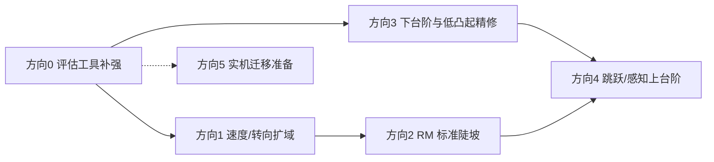

# Wheelbipe 后续优化方向（2026-11-14）

> 依据：[robomaster_wheelleg_evaluation_standard.md](./robomaster_wheelleg_evaluation_standard.md)（RM 评价标尺）、[direction_d_stairs_and_yaw_20261113_report.md](./random_terrain_20261112/direction_d_stairs_and_yaw_20261113_report.md)（方向 D 结果）、`profiles.json` 中 `random_terrain_stairs_20261113` 的当前配置，以及 2026-11-14 展示视频的轨迹分析。
> 当前基线：`dirD2_model_5`（`sha256: ca108ded…e0e6fd`），400 Hz（`WHEELBIPE_INTEGRATION_SUBSTEPS=2`）。

---

## 一、当前基线与硬约束

### 1.1 已达成能力

| 项目 | 结果 |
| --- | --- |
| 3×3 随机坡面（±6/10/14/18%，3 种子） | `81/81`，`vx_mae = 0.0133 m/s`，`wz_mae = 0.0229 rad/s` |
| 跨块过渡（24 个合法过渡） | `24/24`，`vx_mae = 0.01650 m/s` |
| 270 s 蛇形走廊 | `9/9` 航点，`resets = 0` |
| 连续下台阶 30/60/90 mm（3 种子） | `27/27` 到达着陆台 |
| 70 mm × 4 下台阶实录 | `max\|pitch\| = 3.63°`，`max\|roll\| = 2.12°`，`resets = 0` |
| 上台阶 25 mm / 40 mm（extended，`seed=71903`） | 达台 `1/3` / `0/3`，失败原因主要是 `roll` |
| 上台阶 60/120/180 mm | 达台 `0/27` |

### 1.2 当前训练配置中的限制（来自代码与 profile）

| 项目 | 当前值 | 位置 | 影响 |
| --- | --- | --- | --- |
| 前进速度指令范围 | `±0.65 m/s`（`command_speed`） | `profiles.json` → `experiment.py` L49–51 | 策略从未见过更高速度 |
| 偏航角速度指令范围 | `±0.45 rad/s`（`command_yaw`） | 同上 L52–54 | 无快速转向、无小陀螺 |
| 指令重采样周期 | 2–5 s | `command_resampling` | 加减速阶跃样本少 |
| 机身高度指令 | `height_range = [0.245, 0.265]` | `env_cfg.py` L36 | 几乎固定，没有下蹲/伸展模态，无法学跳跃 |
| 腿长范围 | `leg_length_range = [0.15, 0.26]` | `env_cfg.py` L49 | 跳跃可用行程约 0.11 m |
| 轮力矩 / 轮速上限 | `5.0 N·m` / `60 rad/s` | `wheel_effort_limit`、`max_wheel_vel` | 轮缘速度上限约 3.75 m/s |
| 腿力矩 / 腿速上限 | `40 N·m` / `17 rad/s` | `leg_effort_limit`、`experiment.py` L60 | 决定起跳爆发力上限 |
| Actor 观测 | 35 维纯本体感知，无地形高程 | `env_cfg.py` L94 | 无法提前知道台阶，只能被动反应 |
| 域随机化 | 质量、摩擦、刚度、阻尼、力矩、推力、传感器噪声 | `domain_randomization` | **没有动作/观测延迟随机化** |
| 最近两轮微调规模 | 4096 环境 × 12–15 iter，`lr = 1e-5`，actor-only | 方向 D 报告 §四 | 适合小修，不足以学新技能 |

### 1.3 物理可行性粗算（整机 20.66 kg，轮半径 0.0625 m）

- 两轮最大驱动力：`2 × 5.0 / 0.0625 = 160 N`（`motor_effort_scale` 取 0.9 时约 144 N）。
- 坡面重力分量：`20.66 × 9.81 × sinθ ≈ 202.7·sinθ N`。30% 坡（约 16.7°）需要约 58 N，占驱动力约 40%，**力矩足够**；最小静摩擦系数 0.5 对应可爬极限约 26.6°，也足够。
- 结论：**提速和 RM 标准陡坡都不受硬件上限阻挡**，瓶颈在训练分布；**垂直上台阶 ≥ 60 mm** 才是结构和观测上的真实瓶颈。

---

## 二、差距总览（对照 RM 标尺）

| 维度 | 当前评级 | 目标评级 | 主要差距 |
| --- | :---: | :---: | --- |
| 下台阶姿态 | A | A+ | 触地回弹 `vz ≈ +0.3 m/s`，常值左倾约 1.5°–2° |
| 坡面与过渡 | B+ | A | 最大坡度 18%，RM 标准坡 27%–30% 未覆盖 |
| 低凸起抗扰 | B | A | 25–40 mm 双轮不同步触阶时容易 `roll` |
| 速度与转向 | C | A | 0.65 m/s / 0.45 rad/s，远低于 1.5–2.5 m/s / ≥1.5 rad/s |
| 垂直上台阶 | D | B | 无跳跃模态、无前视观测 |
| 实机迁移准备 | 未评估 | — | 缺少延迟随机化、功率统计 |

---

## 三、优化方向（按优先级）

### 方向 0：评估工具补强（前置条件，必须先做）

**为什么先做**：后续每个方向都需要新指标，没有指标就无法判断改动是否有效。

**内容**
1. **速度/转向扫描评估**：新建 `tools/eval_speed_sweep.py`，在平地和 ±10% 坡上分别给定 `vx ∈ {0.5, 1.0, 1.5, 2.0}`、`wz ∈ {0, 0.5, 1.0, 1.5}`，记录跟踪误差、`max|pitch|`、重置原因。
2. **加减速阶跃评估**：`0 → 1.5 → 0 m/s` 阶跃，统计急停时的最大前倾角和停止距离。
3. **姿态质量指标**：在现有障碍评估输出中增加 `max|pitch|`、`max|roll|`、平均 roll 偏置、触地后最大正向 `vz`（回弹）。
4. **功率指标**：从 `physics.jsonl` 的 `tau` 与 `dq` 计算 `Σ|τ·ω|` 的平均值和峰值，作为裁判系统功率约束的参考（不是实际电功率）。

**验收**：对 `dirD2_model_5` 跑一遍，得到一份完整的新基线表；脚本有对应的离线单元测试。

**成本**：只写评估代码，无训练。约 0.5–1 天。

---

### 方向 1（P0）：速度与转向扩域

**目标**：从“低速稳态”提升到“中速敏捷”，达到 RM 标尺 A 级的速度下限。

**改动建议**
- 新 profile（例如 `random_terrain_speed_20261115`），基于 `random_terrain_stairs_20261113`：
  - 使用 `command_lin_vel_x` / `command_ang_vel_z` 字段分阶段扩展：第一阶段 `(-1.0, 1.2)` / `(-1.0, 1.0)`，第二阶段 `(-1.0, 2.0)` / `(-1.5, 1.5)`。
  - `command_resampling` 缩短到 `(1.0, 3.0)`，增加加减速样本。
  - 保留 `command_standing_fraction`，保证静止平衡不退化。
- 奖励：先不改权重，观察 `lin_vel_xy_sigma = 0.09` 在高速下是否过严；若跟踪奖励在高速段塌缩，可按速度比例放宽 sigma。
- 训练：本方向是**新技能**，建议放开 critic（不用 actor-only），迭代数提升到数百级别，并采用速度课程（成功率达标后扩大范围）。

**验收**
- 平地 `vx = 1.5 m/s` 跟踪误差 `< 0.1 m/s`，`wz = 1.0 rad/s` 跟踪误差 `< 0.1 rad/s`。
- 急停 `max|pitch| ≤ 8°`，无重置。
- **回归**：原 81 局坡面、24 过渡、27 局下台阶仍全部通过（这是硬门槛）。

**风险**：高速下下台阶的抛射距离变大，下台阶成功率可能下降；需要在回归中重点看 `stairs_down_90mm`。

---

### 方向 2（P1）：RM 标准陡坡（27%–30%）

**目标**：覆盖 RM 公路坡和高地坡。

**改动建议**
- `random_terrain_map.py` 的 `TERRAIN_TYPES` / `GRADES` 新增 `up22, up26, up30, down22, down26, down30`，或者新建一张陡坡专用地图，避免破坏现有 3×3 地图和已有评估的可比性（**推荐后者**）。
- 先做零样本评估：直接用 `dirD2_model_5` 跑陡坡，确认失败模式（打滑、抬头、坡顶托底还是坡底托底）。
- 再做课程微调：22% → 26% → 30%。
- 配合方向 0 的功率指标，记录陡坡上的轮力矩饱和比例。

**验收**
- 30% 上下坡（3 种子）全部通过，无托底，`min_gimbal` 与 `min_base` 不低于当前坡面基线的 80%。
- 原 18% 以内坡面回归不退化。

**风险**：坡顶折角在 30% 时更尖，可能出现机身底部碰撞；需要检查折角处的 `min_base`。

---

### 方向 3（P2）：下台阶与低凸起姿态精修

**目标**：把下台阶从 A 提升到 A+，把 25–40 mm 上台阶从 `1/3` 提升到稳定通过。

**改动建议**
1. **消除回弹**：新增奖励项，只惩罚正向竖直速度（例如 `relu(vz - 0.1)²`），避免与已有 `lin_vel_z = -1.5` 对下落的约束冲突。
2. **消除常值横滚偏置**：
   - 先诊断：在平地静止和直行时统计左右腿关节角差值，确认偏置来源是策略本身，还是机构/资产存在左右不对称（`env_cfg.py` L46–48 注释提到前后枢轴横向位置不同，需要核对左右两侧是否镜像一致）。
   - 如果是策略问题，加入 roll 角平方惩罚或左右腿动作对称项。
3. **低凸起滚转鲁棒性**：在障碍跑道中加入**斜向接近**（±0.2–0.35 rad）的 25/40 mm 台阶，专门训练双轮不同步触阶。

**验收**
- 70 mm × 4 下台阶：触地后最大正向 `vz < 0.15 m/s`，平均 roll 偏置 `< 0.5°`。
- `platform_up_25mm` 达台 `≥ 8/9`，`platform_up_40mm` 达台 `≥ 6/9`（3 种子）。

**成本**：小规模微调即可，与当前 actor-only 流程一致。

---

### 方向 4（P3）：垂直上台阶能力（跳跃或感知）

**目标**：解锁 60–120 mm 上台阶。这是当前唯一的结构性短板，也是成本最高的方向。

**两条路线**

| 路线 | 做法 | 优点 | 代价 |
| --- | --- | --- | --- |
| A：指令驱动跳跃 | 新增跳跃指令（或高度指令扩展到下蹲区间），分阶段奖励：下蹲 → 伸腿起跳 → 空中收腿 → 落地缓冲 | 不需要新传感器，和 RM 强队路线一致 | 需要扩展观测维度（加跳跃指令），**改变 35 维 Actor 接口**；需要从较早阶段重新训练 |
| B：前视高程观测 | Actor 增加局部高度扫描（只在仿真中，实机需要深度相机或激光） | 下台阶也能提前预蹲，整体姿态更好 | 观测接口改变；实机需要额外感知硬件 |

**建议**：先做路线 A 的可行性验证：
1. 只放宽 `height_range`（例如 `[0.17, 0.265]`），验证策略能否跟踪下蹲高度指令，且不破坏闭环连杆（闭环误差 `< 2 mm`）。
2. 再单独训练一个原地跳跃任务，确认 40 N·m / 17 rad/s 的腿部电机能否产生足够离地高度。
3. 可行后再与地形任务合并。

**验收**
- 原地跳跃：轮子离地 `≥ 0.08 m`，落地无重置。
- `platform_up_60mm` 达台 `≥ 6/9`，`platform_up_120mm` 达台 `≥ 3/9`。

---

### 方向 5（并行，低成本）：实机迁移准备

**内容**
- 域随机化中加入动作延迟（例如 0–20 ms）和观测延迟，验证当前策略对延迟的敏感度。
- 用方向 0 的功率指标找出高功率片段（陡坡、急加速），为实机功率限制做准备。
- 导出 `dirD2_model_5` 的 Actor 为 ONNX/TorchScript，确认 35 维输入、6 维输出与实机控制器接口一致。

**说明**：本文档无法确认项目是否已有实机部署计划，此方向是否执行由用户决定。

---

## 四、推荐执行顺序

| 阶段 | 内容 | 训练规模 | 产出 |
| --- | --- | --- | --- |
| 第 1 步 | 方向 0 | 无训练 | 新评估脚本 + `dirD2_model_5` 完整基线 |
| 第 2 步 | 方向 3 | 小规模微调 | 回弹/偏置/低凸起改进的检查点 |
| 第 3 步 | 方向 1 | 中等规模，含课程 | 中速敏捷检查点 |
| 第 4 步 | 方向 2 | 零样本评估 + 课程微调 | 30% 陡坡检查点 |
| 第 5 步 | 方向 4 | 大规模，可能改观测接口 | 跳跃可行性结论 |

> 方向 3 排在方向 1 之前，是因为它成本低、改动小、风险可控，可以先产出一个更干净的基线，再在此基础上扩速度。如果更看重赛场机动性，可以把方向 1 提前。

---

## 五、每个方向的统一回归门槛

任何新检查点在被称为“新冠军”之前，必须同时满足：

1. 3 种子 3×3 坡面 `81/81`。
2. 24 个合法过渡 `24/24`。
3. 270 s 走廊 `9/9`，`resets = 0`。
4. `stairs_down_{30,60,90}mm` 3 种子 `27/27` 到达。
5. 400 Hz 下闭环误差 `< 2 mm`，无数值异常。

---

## 六、暂不建议做的事

- **不建议直接把速度范围一步扩到 3 m/s 以上**：分布跨度过大，容易破坏已有地形能力。
- **不建议修改现有 3×3 地图的坡度定义**：会让所有历史评估结果失去可比性；新地形应单独建图。
- **不建议在没有方向 0 指标的情况下调奖励**：回弹、偏置和功率目前都没有自动统计，调参无法验证。
